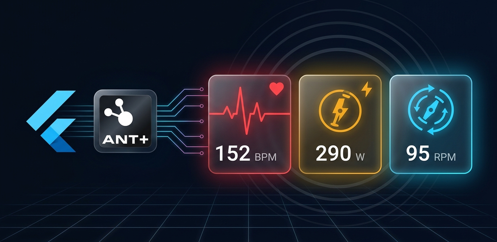

# flutter_antplus

[](https://pub.dev/packages/flutter_antplus)
[](https://github.com/heyteacher/flutter_antplus/blob/main/LICENSE)



> [!IMPORTANT]
> __BREAKING CHANGE__ starting from version `7.0.0` the ANT+ plugin is not required anymore, so:
>
> - uninstall `ANT Radio Service` and `ANT+ USB Service` apps from your device.
> - change the `androidManifest.xml` in your app as describe in [Requirements](#requirements)

A powerful, high-performance __Flutter__ plugin for connecting to __ANT+ devices__ on Android. It allows seamless scanning, connection, and data acquisition from multiple fitness sensors like __heart rate monitors__, __bike power meters__, and __speed/cadence sensors__.

---

## Table of Contents
<!-- TOC -->

- [flutter_antplus](#flutter_antplus)
  - [Table of Contents](#table-of-contents)
  - [Features](#features)
  - [Requirements](#requirements)
  - [Android Setup](#android-setup)
  - [Quick Start](#quick-start)
    - [Initialize Logging (Optional)](#initialize-logging-optional)
    - [Scanning and Connecting](#scanning-and-connecting)
      - [Start Scanning](#start-scanning)
      - [Connect to a Device](#connect-to-a-device)
      - [Monitor Device Connection State](#monitor-device-connection-state)
  - [Reading Sensor Data](#reading-sensor-data)
    - [Heart Rate](#heart-rate)
    - [Bike Power](#bike-power)
    - [Cadence](#cadence)
    - [USB Adapter](#usb-adapter)
  - [For developers](#for-developers)
    - [Pigeon Code Generation](#pigeon-code-generation)
  - [Credits](#credits)
  - [License](#license)

<!-- /TOC -->

## Features

- __Heart Rate Monitor (HRM)__
  - Real-time Heart Rate (bpm) stream

- __Bike Power Meter__
  - Real-time Power (watts)
  - Real-time Cadence (rpm)
  - Pedal Balance (%)
  - Left & Right Pedal Smoothness (%)
  - Left & Right Torque Effectiveness (%)
  - Battery status tracking
  - Show and update crank length (in mm)
  - Show and update advanced capabilities
    - 4 Hertz Trasmission
    - 8 Hertz Trasmission
    - PCO (Platform Center Offset)
    - Power Phase
    - Rider Position
    - Torque Barycenter

- __Cadence Sensor__
  - Real-time Cadence (rpm)

- __Common API (`AntplusDeviceViewModel`)__
  - Universal start/stop scan interface
  - State monitoring (`onDeviceStateChangeStream`)
  - Subscriptions status tracking (`onRequestAccessResultStream`)

- __USB Adapter__
  - USB Adapter state monitoring (`onUsbAdapterStateChangeStream`)

- __Plugin Logging__
  - Integrated debug logging through the `AntplusLogging` singleton

---

## Requirements

- Ant+ USB Stick Receiver Adapter like [this](https://www.amazon.co.uk/s?k=Ant%2B+USB+Stick+Adapter&crid=JJ10ZB811E2K&sprefix=ant%2B+usb+stick+adapter%2Caps%2C150&ref=nb_sb_noss)

- USB C to USB adapter like [this](https://www.amazon.co.uk/s?k=usbc+to+usb+adapter&crid=158X5B00VLVEC&sprefix=usbc+to+usb+adapte%2Caps%2C158&ref=nb_sb_noss_2)
  
---

## Android Setup

- Add the action `USB_DEVICE_ATTACHED`  tag (outside `<activity>`) in your `android/app/src/main/AndroidManifest.xml`:

  ```xml
    <intent-filter>
        .
        .
        <action android:name="android.hardware.usb.action.USB_DEVICE_ATTACHED" />
        <action android:name="android.hardware.usb.action.USB_DEVICE_DETACHED" />
    </intent-filter>
    <meta-data android:name="android.hardware.usb.action.USB_DEVICE_ATTACHED"
        android:resource="@xml/device_filter" />
    <meta-data android:name="android.hardware.usb.action.USB_DEVICE_DETACHED"
        android:resource="@xml/device_filter" />
  ```

- add file `android/app/src/main/res/xml/device_filter.xml` with this content:

  ```xml
  <?xml version="1.0" encoding="utf-8"?>

  <resources>
      <usb-device vendor-id="4047" product-id="4104" />
      <usb-device vendor-id="4047" product-id="4105" />
  </resources>
  ```

---

## Quick Start

A comprehensive example app can be found in [example](example).

### Initialize Logging (Optional)

It is recommended to initialize the logging interface at app startup:

```dart
import 'package:flutter_antplus/antplus_logging.dart';

void main() {
  WidgetsFlutterBinding.ensureInitialized();
  AntplusLogging.instance.initLog();
  runApp(const MyApp());
}
```

### Scanning and Connecting

Each device type has its own view model implementing the `AntplusDeviceViewModel` interface:

- `AntplusHeartrateViewModel.instance`
- `AntplusBikepowerViewModel.instance`
- `AntplusCadenceViewModel.instance`

#### Start Scanning

```dart
final hrViewModel = AntplusHeartrateViewModel.instance;

// Listen to scan results
final scanSubscription = hrViewModel.onScanResultStream.listen((device) {
  print('Found device: ${device.name} (Number: ${device.number})');
});

// Start the scan
await hrViewModel.startScan();
```

#### Connect to a Device

When a device is discovered, you can connect to it using its unique `deviceNumber`:

```dart
// Stop scan before connecting (best practice)
await hrViewModel.stopScan();

// Connect using device number
await hrViewModel.connect(device.number);
```

#### Monitor Device Connection State

```dart
final stateSubscription = hrViewModel.onDeviceStateChangeStream.listen((state) {
  print('Device state changed to: ${state.name}');
  // States: dead, closed, searching, tracking, processingRequest, unrecognized
});
```

---

## Reading Sensor Data

### Heart Rate

```dart
final hrSubscription = AntplusHeartrateViewModel.instance.onHeartRateDataStream.listen((bpm) {
  print('Heart Rate: $bpm bpm');
});
```

### Bike Power

The bike power view model offers multiple specialized telemetry streams:

```dart
final powerModel = AntplusBikepowerViewModel.instance;

// Real-time Power output in watts
powerModel.onPowerDataStream.listen((watts) {
  print('Power: $watts W');
});

// Cadence from the power meter
powerModel.onCadenceDataStream.listen((rpm) {
  print('Cadence: $rpm rpm');
});

// Left/Right Pedal Balance
powerModel.onBalanceDataStream.listen((balance) {
  print('Balance: $balance%');
});

// Pedal Smoothness
powerModel.onPedalSmoothnessDataStream.listen((data) {
  print('Smoothness - Left: ${data.leftOrCombinedPedalSmoothness}%, Right: ${data.rightPedalSmoothness}%');
});

// Torque Effectiveness
powerModel.onTorqueEffectivenessDataStream.listen((data) {
  print('Torque - Left: ${data.leftTorqueEffectiveness}%, Right: ${data.rightTorqueEffectiveness}%');
});

// Battery status of the power meter sensor
powerModel.onBatteryStatusDataStream.listen((status) {
  print('Battery Status: ${status.name}');
});

// Request Advanced Capabilities
powerModel.requestAdvancedCapabilities();
powerModel.onAdvancedCapabilitiesDataStream.listen((capabilities) {
  print('Advanced Capabilities:');
  print('  - 4Hz Transmission: ${capabilities.transmission4HzEnabled}');
  print('  - 8Hz Transmission: ${capabilities.transmission8HzEnabled}');
  print('  - PCO: ${capabilities.platformCenterOffsetEnabled}');
  print('  - Power Phase: ${capabilities.powerPhaseEnabled}');
  print('  - Rider Position: ${capabilities.riderPositionEnabled}');
  print('  - Torque Barycenter: ${capabilities.torqueBarycenterEnabled}');
});

// Set Advanced Capabilities
powerModel.set8Hertz(enable: true);
powerModel.setPCO(enable: true);
powerModel.setPowerPhase(enable: true);
powerModel.setRiderPosition(enable: true);
powerModel.setTorqueBarycenter(enable: true);

// Request Crank Length 
powerModel.requestCrankLength();
powerModel.onCrankLengthUpdateStream.listen((crankLength) {
  print('Crank Length: $crankLength mm');
});

// Set Crank Length
powerModel.setCrankLength(172.5);
```

### Cadence

```dart
final cadenceSubscription = AntplusCadenceViewModel.instance.onCadenceDataStream.listen((rpm) {
  print('Cadence: $rpm rpm');
});
```

### USB Adapter

```dart
final usbAdapterModel = AntplusUsbAdapterViewModel.instance;

usbAdapterModel.usbAdapterStateChangeStream.listen((antplusUsbAdapterState) {
  print('USB Adapter state changed to: ${antplusUsbAdapterState.name}');
  // Usb Adapter States: attached, detached, permissionNotGranted
});
```

---

## For developers

### Pigeon Code Generation

The pigeon definition files are located in the `pigeons/` folder. If you edit these definitions, regenerate the pigeon platform channel implementations calling:

```bash
tool/run_pigeon.sh
```

script which is calling the following commands:

```bash
# Bike Power
dart run pigeon --input pigeons/bikepower.dart 
dart run pigeon --input pigeons/bikepower_event_channel.dart 

# Heart Rate
dart run pigeon --input pigeons/heartrate.dart 
dart run pigeon --input pigeons/heartrate_event_channel.dart 

# Cadence
dart run pigeon --input pigeons/cadence.dart 
dart run pigeon --input pigeons/cadence_event_channel.dart 

# Logging
dart run pigeon --input pigeons/logging_event_channel.dart 

# Device
dart run pigeon --input pigeons/device_event_channel.dart 

# USB Adapter
dart run pigeon --input pigeons/usb_adapter_event_channel.dart
```

---

## Credits

This package in Android plug-in uses [@heyteacher/j-antplus](https://github.com/heyteacher/j-antplus)
a Java Library for speaking with ANT / ANT+ devices through a USB Ant+ Stick.

---

## License

This project is licensed under the BSD-3-Clause License - see the [LICENSE](LICENSE) file for details.
